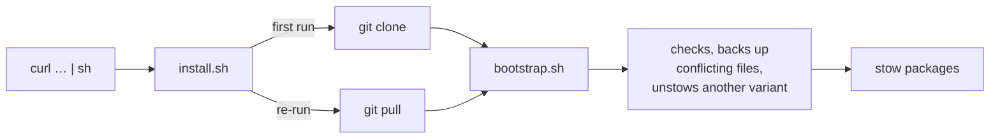

# dotfiles

GNU Stow dotfiles for tmux and a basic zsh, on Linux and macOS, from one
command on a fresh box.

[](LICENSE)

## Quick start

```sh
# default (tmux-full):
curl -fsSL https://raw.githubusercontent.com/GrndZero101/dotfiles/main/install.sh | sh

# choose packages (everything after `--` goes to bootstrap.sh):
curl -fsSL https://raw.githubusercontent.com/GrndZero101/dotfiles/main/install.sh | sh -s -- zsh-antidote tmux-minimal

# or pick them from a list, if fzf is installed:
curl -fsSL https://raw.githubusercontent.com/GrndZero101/dotfiles/main/install.sh | sh -s -- --pick

# no curl? wget works the same:
wget -qO- https://raw.githubusercontent.com/GrndZero101/dotfiles/main/install.sh | sh
```

> [!CAUTION]
> Piping a script into `sh` runs it unread. To read it first:
>
> ```sh
> curl -fsSLO https://raw.githubusercontent.com/GrndZero101/dotfiles/main/install.sh
> less install.sh && sh install.sh
> ```
>
> It never uses `sudo` and never writes outside `$HOME`.

**Prerequisites:** `git` and `stow`, plus the tool each package configures
(`tmux`, `zsh`). On Ubuntu: `sudo apt install git stow tmux zsh`. The
installer checks, and prints the command for anything missing.



The repo is cloned to `~/.config/dotfiles`. Override it with
`DOTFILES_DIR`, `DOTFILES_BRANCH` or `DOTFILES_REPO_URL`
(`sh install.sh --help`).

## Packages

| Package | What it is | Requires | Safe on shell-config machines |
|---|---|---|---|
| [`tmux-full`](tmux-full) | **Default.** tmux with plugins (tpm): catppuccin theme, sesh session picker and its sesh config, vim-aware pane navigation, git, cpu, ram and disk usage status (plus disk and network throughput on Linux), clock with time zone | tmux 3.8+; extras via Homebrew ([`Brewfile`](Brewfile)) | ✅ |
| [`tmux-compact`](tmux-compact) | `tmux-full` with one number per throughput pill: total disk bytes, disk operations and network bytes per second (read plus write, down plus up), and the status line at the top | as `tmux-full` | ✅ |
| [`tmux-quiet`](tmux-quiet) | `tmux-full` with only the cpu and ram pills, from one long-running job that starts no processes once it's running: nothing for endpoint protection to scan on corporate laptops | as `tmux-full`, without gitmux | ✅ |
| [`tmux-raidboss`](tmux-raidboss) | `tmux-full` with everything lit up: a second status line of system and environment modules, and a title bar on every pane | as `tmux-full`; optional extras per module (below) | ✅ |
| [`tmux-minimal`](tmux-minimal) | Pure tmux, no plugins, same muscle memory | tmux 3.2+ | ✅ |
| [`brew`](brew) | A generic Brewfile at `~/.config/homebrew/Brewfile`: what shell-config's profiles use, plus classic Unix CLI tools. Install with `brew bundle --file ~/.config/homebrew/Brewfile` | Homebrew | ✅ |
| [`zsh-minimal`](zsh-minimal) | `~/.zshrc` for fresh boxes: history, completion menu, vi mode. No plugins, no downloads | zsh | ❌ fresh boxes and containers only |
| [`zsh-antidote`](zsh-antidote) | `zsh-minimal` plus zsh-vi-mode and fzf, installed by antidote on first start; works offline | zsh, git; curl or wget for fzf | ❌ fresh boxes and containers only |

Variants of the same tool are alternatives: install exactly one.

<details>
<summary><b>What <code>tmux-raidboss</code>'s HUD line shows, and what each module needs</b></summary>

Modules whose need isn't met are left out when the config loads, so a
missing tool removes one pill rather than leaving a broken one. Reload the
config (<kbd>C-Space</kbd> <kbd>R</kbd>) after adding one.

| Side | Module | Needs |
|---|---|---|
| left | host, user, directory | nothing |
| left | Kubernetes context and namespace | `kubectl` with a current context |
| left | pomodoro timer (empty until started) | nothing |
| right | cpu, ram, load, disk usage | nothing (`vmstat` on Linux, `top` on macOS) |
| right | GPU load | `nvidia-smi` |
| right | disk bytes and operations per second (read, write), network throughput | Linux (reads `/proc`) |
| right | battery | a battery |
| right | weather | internet (wttr.in); shows its last value offline |
| right | uptime | nothing |

</details>

| Machine | Packages |
|---|---|
| Workstation with shell-config | `tmux-full` (the default) |
| Workstation, everything on screen | `tmux-raidboss` |
| Workstation, narrower system pills | `tmux-compact` |
| Corporate laptop with endpoint protection | `tmux-quiet` |
| Server where you only want tmux | `tmux-minimal` |
| Fresh container, full comfort | `zsh-antidote tmux-minimal` |
| Fresh container, nothing downloaded | `zsh-minimal tmux-minimal` |

> [!NOTE]
> The tpm variants (`tmux-full`, `tmux-compact`, `tmux-quiet`,
> `tmux-raidboss`) need
> **tmux 3.8+** (they use `command-prompt -P`). Older distro tmux (Ubuntu
> 24.04 ships 3.4) gets `tmux-minimal`, or tmux from Homebrew.
> `bootstrap.sh` installs their plugins; if you stow one by hand, press
> <kbd>C-Space</kbd> <kbd>I</kbd> once in tmux to install them.

## Usage

Day to day it's plain `stow`, run from the repo root (it reads `.stowrc`):

| Task | Command |
|---|---|
| Install a package | `stow tmux-full` |
| Remove a package | `stow -D tmux-full` |
| Re-link after adding files | `stow -R tmux-full` |
| Dry run | `stow -n -v tmux-full` |
| Switch tmux variant | `tmux kill-server && stow -D tmux-full && stow tmux-raidboss`, then start tmux; the first time, press <kbd>C-Space</kbd> <kbd>I</kbd> to install its plugins |
| Switch zsh variant | `stow -D zsh-minimal && stow zsh-antidote`, then start a new shell |
| Validate the repo | `./check.sh` |
| Check every commit | `prek install`, once per clone; `prek run --all-files` runs the hooks by hand |

`./bootstrap.sh <variant>` does either "Switch" row with checks: it finds the
variant installed now, refuses while tmux is running (a reload can't unset
the old config's settings, so tmux must restart), unstows the old variant,
stows the new one and installs its plugins. `./bootstrap.sh --pick` chooses
the packages in fzf (<kbd>Tab</kbd> to pick more than one), with each one's
description and files in a preview, then prints the command it runs.

> [!TIP]
> Try `tmux-minimal` without installing it. `-L` starts a separate tmux
> server, so your sessions aren't touched:
>
> ```sh
> tmux -L minimal -f "$PWD/tmux-minimal/.config/tmux/tmux.conf" new
> ```

The sesh config in the tpm variants adds two sessions with
fixed aliases: `tc` opens `tmux.conf` in nvim, and `df` opens the repo. Use
`sesh connect tc` from a shell, or find them in the <kbd>C-Space</kbd>
<kbd>T</kbd> picker. They expect the repo at `~/.config/dotfiles`, the
installer's default; if you cloned elsewhere, symlink it there.

All tmux configs use the prefix <kbd>C-Space</kbd>. In nested tmux (say
`tmux-full` locally, `tmux-minimal` over SSH), press it twice to reach the
inner one: <kbd>C-Space</kbd> <kbd>C-Space</kbd> <kbd>c</kbd>.

<details>
<summary><b>Key bindings that differ from stock tmux and zsh</b></summary>

### All tmux configs

| Keys | Action |
|---|---|
| <kbd>C-Space</kbd> | prefix (instead of <kbd>C-b</kbd>) |
| <kbd>C-Space</kbd> <kbd>"</kbd> / <kbd>%</kbd> / <kbd>c</kbd> | split or new window, keeping the current directory |
| <kbd>v</kbd>, <kbd>y</kbd> in copy mode | vi selection; copy to the system clipboard (OSC 52, works over SSH) |

**`tmux-full`, `tmux-compact`, `tmux-quiet` and `tmux-raidboss`**

| Keys | Action |
|---|---|
| <kbd>C-h</kbd> <kbd>C-j</kbd> <kbd>C-k</kbd> <kbd>C-l</kbd> | move between panes, or pass through to vim, fzf and Claude Code |
| <kbd>C-Space</kbd> <kbd>T</kbd> | sesh session picker: <kbd>C-a</kbd> all, <kbd>C-t</kbd> tmux, <kbd>C-g</kbd> configs, <kbd>C-x</kbd> zoxide, <kbd>C-f</kbd> find, <kbd>C-d</kbd> kill session |
| <kbd>C-Space</kbd> <kbd>:</kbd> | command prompt inside the active pane |
| <kbd>C-Space</kbd> <kbd>R</kbd> | reload the config (tmux-sensible) |
| <kbd>C-Space</kbd> <kbd>I</kbd> / <kbd>U</kbd> | install / update plugins (tpm) |

**`tmux-raidboss` only**

| Keys | Action |
|---|---|
| <kbd>C-Space</kbd> <kbd>b</kbd> | start / pause a pomodoro, tmux-pomodoro-plus (<kbd>p</kbd> stays previous window) |
| <kbd>C-Space</kbd> <kbd>C-b</kbd> / <kbd>M-b</kbd> | pomodoro menu / custom length |
| <kbd>C-Space</kbd> <kbd>P</kbd> / <kbd>_</kbd> / <kbd>e</kbd> | cancel / skip / restart it |
| <kbd>C-Space</kbd> <kbd>H</kbd> | hide / show the HUD line |

**`tmux-minimal` only**

| Keys | Action |
|---|---|
| <kbd>C-Space</kbd> <kbd>h</kbd> <kbd>j</kbd> <kbd>k</kbd> <kbd>l</kbd> | move between panes (prefixed, so <kbd>C-h</kbd>… stay with the program) |
| <kbd>C-Space</kbd> <kbd>H</kbd> <kbd>J</kbd> <kbd>K</kbd> <kbd>L</kbd> | resize the pane (repeatable) |
| <kbd>C-Space</kbd> <kbd>r</kbd> | reload whichever config file was loaded |
| <kbd>C-Space</kbd> <kbd>s</kbd> | built-in session tree, instead of the sesh picker |

### Both zsh configs

| Keys | Action |
|---|---|
| <kbd>Esc</kbd> / <kbd>i</kbd> | vi normal / insert mode. `zsh-antidote` adds text objects (`ciw`, `di"`), surround, visual mode and a mode-shaped cursor |
| <kbd>C-a</kbd> <kbd>C-e</kbd> | start / end of line |
| <kbd>C-p</kbd> <kbd>C-n</kbd> | previous / next history line starting with the first word typed |
| <kbd>C-r</kbd> | history search; fuzzy when fzf 0.48+ is present |
| <kbd>C-t</kbd>, <kbd>Alt-c</kbd> | fzf file picker, fzf `cd` (with fzf 0.48+) |
| `mkcd dir` | make a directory and `cd` into it |

</details>

## Updating

Re-run the one-liner: it pulls the repo and re-stows. Plugins update only
when you ask; nothing updates itself at startup.

| What | Command |
|---|---|
| The repo | re-run the one-liner, or `git -C ~/.config/dotfiles pull` |
| `brew` package's tools | `brew bundle --file ~/.config/homebrew/Brewfile` (installs and upgrades) |
| `tmux-full` / `tmux-compact` / `tmux-quiet` / `tmux-raidboss` plugins | <kbd>C-Space</kbd> <kbd>U</kbd>, then type `all` and press <kbd>Enter</kbd> |
| Plugins dropped from the config | <kbd>C-Space</kbd> <kbd>Alt-u</kbd> (tpm removes them) |
| `zsh-antidote` plugins | `antidote update` |
| `zsh-antidote`'s fzf binary | `"$(antidote path junegunn/fzf)/install" --bin`, after `antidote update` |

> [!WARNING]
> In tpm's update prompt (<kbd>C-Space</kbd> <kbd>U</kbd>), pressing
> <kbd>Enter</kbd> alone **cancels**. Type `all` first.

## Uninstalling

From the repo root, `stow -D <package>` removes its links. Then:

- **Backups** of files that were in the way are in
  `~/.local/state/dotfiles-backup/<timestamp>/`, at their original paths.
  Move back whatever you want.
- **Safe to delete** (downloaded or generated): `~/.config/tmux/plugins/`,
  `~/.cache/zsh/`, `~/.cache/antidote/`, `~/.local/share/antidote/`.
- **Your zsh history** is in `~/.local/state/zsh/history`. Keep it, or not.

## Coexisting with shell-config

[shell-config](https://github.com/GrndZero101/shell-config) owns rich zsh
setups. This repo works alongside it and never ships `~/.zshenv`.

> [!IMPORTANT]
> **Don't stow `zsh-*` on a shell-config machine.** Its `~/.zshenv` sets
> `ZDOTDIR`, so zsh never reads `~/.zshrc` and the package silently does
> nothing. `bootstrap.sh` refuses when `~/.zshenv` exists. The tmux
> packages are safe everywhere.

To move a box from `zsh-*` to shell-config, `stow -D` the zsh package, then
install shell-config. Tool hooks such as zoxide (which feeds the sesh
picker) belong in your shell-config profile on those machines.

shell-config's curated `brew` module keeps a whole-machine Brewfile in step
with what's installed (`HOMEBREW_BUNDLE_FILE`). Keep that file private, for
example in `shell-config.local`. The `brew` package here is a baseline to
install from, not that file: `brew-sync` against it would offer to uninstall
everything it doesn't list.

## Testing on a fresh box

The `zsh-*` packages are only ever tested in containers.
[`test/Dockerfile`](test/Dockerfile) is vanilla Ubuntu plus zsh, tmux,
stow, git and curl.

```sh
docker build -t dotfiles-box test/                    # needs network once
docker run --rm -it -v "$PWD":/dotfiles:ro dotfiles-box bash
# inside, install the committed branch through the installer itself:
git config --global --add safe.directory '*'          # the mount has another owner
DOTFILES_REPO_URL=file:///dotfiles DOTFILES_BRANCH=main \
  sh /dotfiles/install.sh zsh-antidote tmux-minimal   # or zsh-minimal
zsh                                                   # then try tmux
```

- **Offline:** add `--network none` to `docker run`. `zsh-minimal` stays
  silent; `zsh-antidote` prints one warning line and falls back to plain vi
  mode, retrying an hour later.
- **Unreachable or black-holed GitHub:** `--add-host github.com:127.0.0.1`
  fails fast; `--add-host github.com:10.255.255.1` gives up after 30s.
- **Other Ubuntu or packages:** `--build-arg UBUNTU=22.04` (tmux 3.2a),
  `--build-arg PKGS="zsh tmux stow git"` (no curl).
- **Uncommitted changes:**
  `cp -r /dotfiles ~/dotfiles && ~/dotfiles/bootstrap.sh …`

<details>
<summary><b>Notes for vanilla boxes</b></summary>

- The Ubuntu Docker image has no zsh: `apt install zsh`.
- Ubuntu's `/etc/zsh/zshrc` already runs `compinit`, so it runs twice. That
  costs a few milliseconds; the fix belongs in `~/.zshenv`, which this repo
  never ships.
- `zsh-antidote`'s fzf needs curl or wget, which the bare `ubuntu` image
  lacks. Without them it's skipped silently, and you get no fzf bindings.
- macOS `/etc/zprofile` reorders `PATH` for login shells. Brew is set up in
  `.zshrc`, after that, so it stays first.
- The clipboard (OSC 52) needs a terminal that accepts it: Windows
  Terminal, iTerm2, Ghostty, WezTerm and kitty do. A tmux nested inside
  `tmux-full` can't reach the clipboard, because the outer tmux drops it.

</details>

## Design

Built on the **Iron Boomer Doctrine**: complexity has to earn its place.

1. Built-in beats plugin, plugin beats script, script beats framework.
2. No abstraction before the second use.
3. Plain tools used directly: `stow`, not a wrapper.
4. Fail loudly, not cleverly.
5. Every package works on a vanilla box, even offline (the tpm variants'
   plugins are the documented exceptions).

Four structural choices follow from it:

- **One stow package per tool variant**, not one package at the repo root.
  Stow then guarantees that only one variant owns a path, each machine
  stows just the subset it needs, and the README and scripts are never
  linked into `$HOME`.
- **`--no-folding`** (in `.stowrc`): stow links files, not directories, so
  a tool that writes into its config directory (tpm's `plugins/`) never
  writes into the repo.
- **No pinning:** plugins track their default branches and update only
  when you ask.
- **Status pills from one long-running job:** the cpu, ram, disk and
  network pills all read one `sysmon.sh` that keeps running and prints a
  line every 5s, instead of commands tmux starts on every refresh. The
  status line starts about two processes a minute, not thousands, which
  matters wherever endpoint protection scans every process start.

The full version, with the package conventions, is in
[`CLAUDE.md`](CLAUDE.md). Open and parked work is in [`TODO.md`](TODO.md).

## License

[MIT](LICENSE)
