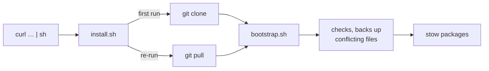

# dotfiles

GNU Stow dotfiles for tmux and a basic zsh, on Linux and macOS, from one
command on a fresh box.

[](LICENSE)

## Quick start

```sh
# default (tmux-full):
curl -fsSL https://raw.githubusercontent.com/GrndZero101/dotfiles/main/install.sh | sh

# choose packages (everything after `--` goes to bootstrap.sh):
curl -fsSL https://raw.githubusercontent.com/GrndZero101/dotfiles/main/install.sh | sh -s -- zsh-antidote tmux-minimal

# no curl? wget works the same:
wget -qO- https://raw.githubusercontent.com/GrndZero101/dotfiles/main/install.sh | sh
```

> [!CAUTION]
> Piping a script into `sh` runs it unread. To read it first:
> ```sh
> curl -fsSLO https://raw.githubusercontent.com/GrndZero101/dotfiles/main/install.sh
> less install.sh && sh install.sh
> ```
> It never uses `sudo` and never writes outside `$HOME`.

**Prerequisites:** `git` and `stow`, plus the tool each package configures
(`tmux`, `zsh`). On Ubuntu: `sudo apt install git stow tmux zsh`. The
installer checks, and prints the command for anything missing.



The repo is cloned to `~/.config/dotfiles`. Override it with
`DOTFILES_DIR`, `DOTFILES_BRANCH` or `DOTFILES_REPO_URL`
(`sh install.sh --help`).

## Packages

| Package | What it is | Requires | Safe on shell-config machines |
|---|---|---|---|
| [`tmux-full`](tmux-full) | **Default.** tmux with plugins (tpm): catppuccin theme, sesh session picker, vim-aware pane navigation, cpu/weather/git status | tmux 3.8+; extras via Homebrew ([`Brewfile`](Brewfile)) | ✅ |
| [`tmux-minimal`](tmux-minimal) | Pure tmux, no plugins, same muscle memory | tmux 3.2+ | ✅ |
| [`zsh-minimal`](zsh-minimal) | `~/.zshrc` for fresh boxes: history, completion menu, vi mode. No plugins, no downloads | zsh | ❌ fresh boxes and containers only |
| [`zsh-antidote`](zsh-antidote) | `zsh-minimal` plus zsh-vi-mode and fzf, installed by antidote on first start; works offline | zsh, git; curl or wget for fzf | ❌ fresh boxes and containers only |

Variants of the same tool are alternatives: install exactly one.

| Machine | Packages |
|---|---|
| Workstation with shell-config | `tmux-full` (the default) |
| Server where you only want tmux | `tmux-minimal` |
| Fresh container, full comfort | `zsh-antidote tmux-minimal` |
| Fresh container, nothing downloaded | `zsh-minimal tmux-minimal` |

> [!NOTE]
> `tmux-full` needs **tmux 3.8+** (it uses `command-prompt -P`). Older
> distro tmux (Ubuntu 24.04 ships 3.4) gets `tmux-minimal`, or tmux from
> Homebrew. `bootstrap.sh` installs its plugins; if you stow `tmux-full` by
> hand, press <kbd>C-Space</kbd> <kbd>I</kbd> once in tmux to install them.

## Usage

Day to day it's plain `stow`, run from the repo root (it reads `.stowrc`):

| Task | Command |
|---|---|
| Install a package | `stow tmux-full` |
| Remove a package | `stow -D tmux-full` |
| Re-link after adding files | `stow -R tmux-full` |
| Dry run | `stow -n -v tmux-full` |
| Switch tmux variant | `stow -D tmux-full && stow tmux-minimal` |
| Switch zsh variant | `stow -D zsh-minimal && stow zsh-antidote` |
| Validate the repo | `./check.sh` |

> [!TIP]
> Try `tmux-minimal` without installing it. `-L` starts a separate tmux
> server, so your sessions aren't touched:
> ```sh
> tmux -L minimal -f "$PWD/tmux-minimal/.config/tmux/tmux.conf" new
> ```

Both tmux configs use the prefix <kbd>C-Space</kbd>. In nested tmux (say
`tmux-full` locally, `tmux-minimal` over SSH), press it twice to reach the
inner one: <kbd>C-Space</kbd> <kbd>C-Space</kbd> <kbd>c</kbd>.

<details>
<summary><b>Key bindings that differ from stock tmux and zsh</b></summary>

**Both tmux configs**

| Keys | Action |
|---|---|
| <kbd>C-Space</kbd> | prefix (instead of <kbd>C-b</kbd>) |
| <kbd>C-Space</kbd> <kbd>"</kbd> / <kbd>%</kbd> / <kbd>c</kbd> | split or new window, keeping the current directory |
| <kbd>v</kbd>, <kbd>y</kbd> in copy mode | vi selection; copy to the system clipboard (OSC 52, works over SSH) |

**`tmux-full` only**

| Keys | Action |
|---|---|
| <kbd>C-h</kbd> <kbd>C-j</kbd> <kbd>C-k</kbd> <kbd>C-l</kbd> | move between panes, or pass through to vim, fzf and Claude Code |
| <kbd>C-Space</kbd> <kbd>T</kbd> | sesh session picker: <kbd>C-a</kbd> all, <kbd>C-t</kbd> tmux, <kbd>C-g</kbd> configs, <kbd>C-x</kbd> zoxide, <kbd>C-f</kbd> find, <kbd>C-d</kbd> kill session |
| <kbd>C-Space</kbd> <kbd>:</kbd> | command prompt inside the active pane |
| <kbd>C-Space</kbd> <kbd>R</kbd> | reload the config (tmux-sensible) |
| <kbd>C-Space</kbd> <kbd>I</kbd> / <kbd>U</kbd> | install / update plugins (tpm) |

**`tmux-minimal` only**

| Keys | Action |
|---|---|
| <kbd>C-Space</kbd> <kbd>h</kbd> <kbd>j</kbd> <kbd>k</kbd> <kbd>l</kbd> | move between panes (prefixed, so <kbd>C-h</kbd>… stay with the program) |
| <kbd>C-Space</kbd> <kbd>H</kbd> <kbd>J</kbd> <kbd>K</kbd> <kbd>L</kbd> | resize the pane (repeatable) |
| <kbd>C-Space</kbd> <kbd>r</kbd> | reload whichever config file was loaded |
| <kbd>C-Space</kbd> <kbd>s</kbd> | built-in session tree, instead of the sesh picker |

**Both zsh configs**

| Keys | Action |
|---|---|
| <kbd>Esc</kbd> / <kbd>i</kbd> | vi normal / insert mode. `zsh-antidote` adds text objects (`ciw`, `di"`), surround, visual mode and a mode-shaped cursor |
| <kbd>C-a</kbd> <kbd>C-e</kbd> | start / end of line |
| <kbd>C-p</kbd> <kbd>C-n</kbd> | previous / next history line starting with the first word typed |
| <kbd>C-r</kbd> | history search; fuzzy when fzf 0.48+ is present |
| <kbd>C-t</kbd>, <kbd>Alt-c</kbd> | fzf file picker, fzf `cd` (with fzf 0.48+) |
| `mkcd dir` | make a directory and `cd` into it |

</details>

## Updating

Re-run the one-liner: it pulls the repo and re-stows. Plugins update only
when you ask; nothing updates itself at startup.

| What | Command |
|---|---|
| The repo | re-run the one-liner, or `git -C ~/.config/dotfiles pull` |
| `tmux-full` plugins | <kbd>C-Space</kbd> <kbd>U</kbd>, then type `all` and press <kbd>Enter</kbd> |
| `zsh-antidote` plugins | `antidote update` |
| `zsh-antidote`'s fzf binary | `"$(antidote path junegunn/fzf)/install" --bin`, after `antidote update` |

> [!WARNING]
> In tpm's update prompt (<kbd>C-Space</kbd> <kbd>U</kbd>), pressing
> <kbd>Enter</kbd> alone **cancels**. Type `all` first.

## Uninstalling

From the repo root, `stow -D <package>` removes its links. Then:

- **Backups** of files that were in the way are in
  `~/.local/state/dotfiles-backup/<timestamp>/`, at their original paths.
  Move back whatever you want.
- **Safe to delete** (downloaded or generated): `~/.config/tmux/plugins/`,
  `~/.cache/zsh/`, `~/.cache/antidote/`, `~/.local/share/antidote/`.
- **Your zsh history** is in `~/.local/state/zsh/history`. Keep it, or not.

## Coexisting with shell-config

[shell-config](https://github.com/GrndZero101/shell-config) owns rich zsh
setups. This repo works alongside it and never ships `~/.zshenv`.

> [!IMPORTANT]
> **Don't stow `zsh-*` on a shell-config machine.** Its `~/.zshenv` sets
> `ZDOTDIR`, so zsh never reads `~/.zshrc` and the package silently does
> nothing. `bootstrap.sh` refuses when `~/.zshenv` exists. The tmux
> packages are safe everywhere.

To move a box from `zsh-*` to shell-config, `stow -D` the zsh package, then
install shell-config. Tool hooks such as zoxide (which feeds the sesh
picker) belong in your shell-config profile on those machines.

## Testing on a fresh box

The `zsh-*` packages are only ever tested in containers.
[`test/Dockerfile`](test/Dockerfile) is vanilla Ubuntu plus zsh, tmux,
stow, git and curl.

```sh
docker build -t dotfiles-box test/                    # needs network once
docker run --rm -it -v "$PWD":/dotfiles:ro dotfiles-box bash
# inside, install the committed branch through the installer itself:
git config --global --add safe.directory '*'          # the mount has another owner
DOTFILES_REPO_URL=file:///dotfiles DOTFILES_BRANCH=main \
  sh /dotfiles/install.sh zsh-antidote tmux-minimal   # or zsh-minimal
zsh                                                   # then try tmux
```

- **Offline:** add `--network none` to `docker run`. `zsh-minimal` stays
  silent; `zsh-antidote` prints one warning line and falls back to plain vi
  mode, retrying an hour later.
- **Unreachable or black-holed GitHub:** `--add-host github.com:127.0.0.1`
  fails fast; `--add-host github.com:10.255.255.1` gives up after 30s.
- **Other Ubuntu or packages:** `--build-arg UBUNTU=22.04` (tmux 3.2a),
  `--build-arg PKGS="zsh tmux stow git"` (no curl).
- **Uncommitted changes:** `cp -r /dotfiles ~/dotfiles && ~/dotfiles/bootstrap.sh …`

<details>
<summary><b>Notes for vanilla boxes</b></summary>

- The Ubuntu Docker image has no zsh: `apt install zsh`.
- Ubuntu's `/etc/zsh/zshrc` already runs `compinit`, so it runs twice. That
  costs a few milliseconds; the fix belongs in `~/.zshenv`, which this repo
  never ships.
- `zsh-antidote`'s fzf needs curl or wget, which the bare `ubuntu` image
  lacks. Without them it's skipped silently, and you get no fzf bindings.
- macOS `/etc/zprofile` reorders `PATH` for login shells. Brew is set up in
  `.zshrc`, after that, so it stays first.
- The clipboard (OSC 52) needs a terminal that accepts it: Windows
  Terminal, iTerm2, Ghostty, WezTerm and kitty do. A tmux nested inside
  `tmux-full` can't reach the clipboard, because the outer tmux drops it.

</details>

## Design

Built on the **Iron Boomer Doctrine**: complexity has to earn its place.

1. Built-in beats plugin, plugin beats script, script beats framework.
2. No abstraction before the second use.
3. Plain tools used directly: `stow`, not a wrapper.
4. Fail loudly, not cleverly.
5. Every package works on a vanilla box, even offline (`tmux-full`'s
   plugins are the documented exception).

The full version, with the package conventions, is in
[`CLAUDE.md`](CLAUDE.md).

## License

[MIT](LICENSE)
